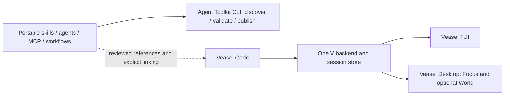

<p align="center"><strong>Portable skills, agents, and workflows for AI coding tools.</strong></p>

<div align="center">

# agent-toolkit

> **New here?** Use [Veasel Code](https://veasel.dev/) for interactive coding in the TUI or Desktop. Start with [Getting Started](docs/GETTING_STARTED.md) to install Agent Toolkit's portable capability CLI.

**Portable skills, agent definitions, workflows, integrations, and a native automation CLI for coding assistants**

[](https://github.com/ulises-jeremias/agent-toolkit/actions/workflows/validate.yml)
[](https://github.com/ulises-jeremias/agent-toolkit/releases/latest)
[](https://github.com/ulises-jeremias/agent-toolkit/releases)
[](LICENSE)
[](https://github.com/ulises-jeremias/agent-toolkit/stargazers)

[Documentation](docs/) ·
[Official website](https://agent-toolkit.io) ·
[Veasel Code](https://github.com/veasel-labs/veasel) ·
[CLI Install](#-cli-quick-install) ·
[Skills](#%EF%B8%8F-skills--catalog-via-agent-toolkit-inventory) ·
[Agents](#-agent-personas) ·
[Loops](#-loop-engineering) ·
[Swarm v1 retirement](#swarm-v1-retirement-status) ·
[Contributing](#-contributing)

</div>

---

## ✨ What is agent-toolkit?

Agent Toolkit is the portable capability layer and native CLI. It distributes
reusable Skills, Agent Definitions, MCP templates, and workflow recipes across
coding assistants. [Veasel](https://github.com/veasel-labs/veasel) is the
supported coding product: its TUI and Desktop are designed around one backend
and session store; packaged shared-session acceptance is tracked in
[Veasel #550](https://github.com/veasel-labs/veasel/issues/550). Veasel can
consume selected portable capabilities from this repository.
The former Toolkit Electron Desktop is retired from new releases; existing
installations and data remain untouched and are not automatically imported.



## Key Concepts

<table>
  <tr>
    <td width="50%" valign="top">
      <h3>🛠️ Skills</h3>
      <sub>Reusable capability units (<code>SKILL.md</code>) that teach an agent how to do a job — delivery workflows, forge CLIs, design, data, ops.</sub>
      <br><br>
      <sub>Browse the live catalog with <code>agent-toolkit inventory</code> or inspect <code>skills/</code>.</sub>
    </td>
    <td width="50%" valign="top">
      <h3>🤖 Agents</h3>
      <sub>Reusable Agent Definitions describe how a runner should work. Former Toolkit People records are workspace data declarations, not live sessions.</sub>
      <br><br>
      <sub>Definitions under <code>agents/</code>; the historical People data contract is documented in <a href="docs/PEOPLE.md">People compatibility</a>.</sub>
    </td>
  </tr>
  <tr>
    <td width="50%" valign="top">
      <h3>🔄 Loops</h3>
      <sub>Recurring agentic workflows with mutation-safety Stages (L1 observe → L2 controlled → L3 high autonomy).</sub>
      <br><br>
      <sub><code>agent-toolkit loop run daily-triage</code> · templates in <code>loops/</code> — see <code>agent-toolkit inventory</code></sub>
    </td>
    <td width="50%" valign="top">
      <h3>📦 Packs</h3>
      <sub>Repository solution packs are docs-only workflow guides. They are distinct from workspace context packs and loop runtime overrides; none are installation bundles.</sub>
      <br><br>
      <sub>See <a href="docs/CONCEPTS.md#three-kinds-of-packs">the three pack types</a> and <a href="packs/README.md">solution pack guides</a>.</sub>
    </td>
  </tr>
  <tr>
    <td width="50%" valign="top">
      <h3>🧩 Plugins</h3>
      <sub>Product distributions for Claude Code / Cursor marketplaces — core, agents, forge — compiled from one catalog.</sub>
      <br><br>
      <sub>Source of truth: <code>distributions/products.yaml</code></sub>
    </td>
    <td width="50%" valign="top">
      <h3>🔗 MCP</h3>
      <sub>Provider registry + ready templates (GitHub, Slack, Notion, Linear, Figma, ClickUp, Chrome DevTools) emitted into target-native MCP configs.</sub>
      <br><br>
      <sub>Provider definitions and templates live under <code>mcp/</code>; inspect or configure them with <code>agent-toolkit mcp</code>.</sub>
    </td>
  </tr>
</table>

---

## 🚀 CLI Quick Install

**Recommended:** the product CLI is the **native V binary**. PyPI/`uv` is a thin launcher over that binary ([ADR-021](docs/adrs/ADR-021-pypi-binary.md)).

```bash
# GitHub Release — current native V binary + SHA256SUMS
# https://github.com/ulises-jeremias/agent-toolkit/releases/latest

# Homebrew
brew tap ulises-jeremias/homebrew-tap && brew install agent-toolkit

# AUR (Arch) — native V binary; not the Python AUR package
yay -S agent-toolkit-bin

# PyPI launcher (execs bundled V; ADR-021)
uv tool install agent-toolkit-cli
uvx --from agent-toolkit-cli agent-toolkit install

# npm
npm i -g agent-toolkit-cli

agent-toolkit install    # auto-detects Claude, Cursor, OpenCode, Windsurf, Pi, Copilot
agent-toolkit doctor     # verify everything is set up
```

> **Support matrix:** see [`docs/TRUST.md#Installation channels`](docs/TRUST.md#installation-channels) for the single channel table (GitHub Releases canonical artifact, PyPI, npm, Homebrew, AUR, GHCR container, Claude/Cursor marketplaces, Agent Plugins artifacts) with trust anchor, support level, and verification command. The product CLI is the **native V binary**; Python is a thin launcher — see `docs/RELEASING.md` (canonical artifact) and `docs/TRUST.md`.

→ Full walkthrough: [docs/INSTALLATION.md](docs/INSTALLATION.md) · Full channel matrix: [docs/TRUST.md#Installation channels](docs/TRUST.md#installation-channels)

### Advanced install methods

Use these only when the primary CLI flow above does not fit your setup.

<details>
<summary><strong>Claude Code plugin marketplace</strong> — native plugins for Claude Code only</summary>

```
/plugin marketplace add ulises-jeremias/agent-toolkit
/plugin install agent-toolkit-core@agent-toolkit
/plugin install agent-toolkit-agents@agent-toolkit
/plugin install agent-toolkit-forge@agent-toolkit
```

</details>

<details>
<summary><strong>Cursor plugins</strong> — Cursor IDE and Cursor Agent CLI</summary>

Native plugins from [`.cursor-plugin/marketplace.json`](.cursor-plugin/marketplace.json):
`agent-toolkit-core`, `agent-toolkit-agents`, `agent-toolkit-forge`.

**Cursor IDE**

1. Open **Customize** in the sidebar and choose **Plugins → Add → From GitHub Repository**.
2. Enter `https://github.com/ulises-jeremias/agent-toolkit`.
3. Install the plugins you need (`agent-toolkit-core` is the baseline) at user or project scope. See the [current Cursor plugin guide](https://cursor.com/docs/plugins).

User-scoped installs sync to Cursor Agent CLI sessions automatically.

**Cursor Agent CLI**

```bash
# Open Cursor Agent and use its current plugin install flow.
# See https://cursor.com/docs/plugins for the current CLI syntax and scope options.
cursor-agent
```

Load a local plugin directory for one session (useful while developing):

```bash
cursor-agent --plugin-dir ./plugins/agent-toolkit-core
cursor-agent --plugin-dir ./plugins/agent-toolkit-agents
cursor-agent --plugin-dir ./plugins/agent-toolkit-forge
```

**Local / offline**

```bash
# Symlink into Cursor's local plugin dir, then reload the window
mkdir -p ~/.cursor/plugins/local
ln -s "$(pwd)/plugins/agent-toolkit-core" ~/.cursor/plugins/local/agent-toolkit-core
ln -s "$(pwd)/plugins/agent-toolkit-agents" ~/.cursor/plugins/local/agent-toolkit-agents
ln -s "$(pwd)/plugins/agent-toolkit-forge" ~/.cursor/plugins/local/agent-toolkit-forge
```

→ [Cursor plugins docs](https://cursor.com/docs/plugins) · [Plugin marketplace guide](docs/wiki/Plugin-Marketplace.md)

</details>

<details>
<summary><strong>npx skills</strong> — Agent Skills standard (skills only, no agents/loops)</summary>

```bash
npx skills add ulises-jeremias/agent-toolkit -g
```

</details>

<details>
<summary><strong>Homebrew / AUR / GHCR</strong> — system packages and container</summary>

Formulas live in dedicated repos ([homebrew-tap](https://github.com/ulises-jeremias/homebrew-tap), [aur-packages](https://github.com/ulises-jeremias/aur-packages)); release workflows notify them on tag. The container image ships the same GitHub Release V binary.

```bash
brew tap ulises-jeremias/homebrew-tap && brew install agent-toolkit
yay -S agent-toolkit-bin   # Arch Linux (AUR) — GitHub Release V binary; not the Python AUR package
npm i -g agent-toolkit-cli # optionalDependencies platform packages
docker pull ghcr.io/ulises-jeremias/agent-toolkit
```

</details>

<details>
<summary><strong>Git clone + install script</strong> — offline or pinned commit</summary>

```bash
git clone https://github.com/ulises-jeremias/agent-toolkit ~/.agent-toolkit
./make.vsh install-cli    # canonical V binary → ~/.local/bin (or --prefix=…)
agent-toolkit install
```

Prefer `./make.vsh install-cli` or a release channel above ([ADR-007](docs/adrs/ADR-007-install-sh-deprecation.md) removed the deprecated `scripts/install.sh` wrapper).

</details>

<details>
<summary><strong>Manual per-tool copy</strong> — full control over paths</summary>

```bash
git clone https://github.com/ulises-jeremias/agent-toolkit ~/.agent-toolkit

# Claude Code — reference in .claude/settings.json
# Cursor — copy profiles/cursor/rules/*.mdc → .cursor/rules/
# OpenCode — copy profiles/opencode/ → ~/.config/opencode/
# Copilot — copy profiles/copilot/copilot-instructions.md → .github/
# Windsurf — copy profiles/windsurf/ → ~/.codeium/windsurf/
# Pi Agent — copy profiles/pi/skills/ → ~/.pi/agent/skills/
```

Per-tool steps: [docs/INSTALLATION.md#manual-install](docs/INSTALLATION.md#manual-install)

</details>

---

## 🖥️ Supported Tools

| Tool | Type | What's deployed |
| ------ | ------ | ----------------- |
| **Claude Code** | Plugin + CLI | Plugin manifest, skill references, settings |
| **Cursor** | Plugin + IDE + Agent CLI | Marketplace plugins (`.cursor-plugin/`), `.mdc` rules via profile |
| **OpenCode** | TUI | System prompt overlays, agent configs |
| **GitHub Copilot** | IDE | `copilot-instructions.md` with domain selection |
| **Windsurf** | IDE | Rules and memory files via Cascade |
| **Pi Agent** | Agentic harness | Skills and loop templates in Pi's native format |
| **Muse Code** | CLI | Agent Skills under `~/.config/muse/skills/` |

---

## 🛠️ Skills — catalog via `agent-toolkit inventory`

All skills use `SKILL.md` frontmatter only — no `skill.json` required. Fully compliant with the [Agent Skills spec](https://github.com/vercel-labs/skills). Live counts: `agent-toolkit inventory` / `catalogs/skill-catalog.yaml` (source of truth, not README badges). Marketplace plugins ship a subset (core + forge); `agent-toolkit-complete` is the full catalog.

| Domain | Key Skills |
| -------- | ------------ |
| 🧠 `core` | assistant, dev-companion, workspace, project, onboarding |
| 🚀 `delivery` | adr, bug, epic, development-workflow, planning, prd, user-story, work-item |
| 🎨 `design` | figma-implement-design, figma-code-connect-components, frontend-design |
| ⚡ `forge` | github-cli-workflow, gitlab-cli-workflow, gh-fix-ci, worktree |
| 🔗 `integrations` | slack-cli, slack-assistant, linear, clickup-cli, mcp, jira-*, confluence-* |
| 📊 `data` | dbt-validation, snowflake-validation |
| 🔧 `tooling` | jupyter-notebook, playwright-cli, herdr, inventory |
| 🛡️ `ops` | triage, docs-generator, llm-cost-advisor, swarm |
| 🔄 `loops` | loop-runner (see [Loop Engineering](#-loop-engineering) for available templates) |
| 🔐 `agentic-security` | threat-modeling, owasp-agentic-review, mcp-audit |
| ☁️ `cloud` | cloud-design-patterns, aws-well-architected-review |
| 🏛️ `architecture` | architecture-diagram, c4-model |
| ♿ `accessibility` | review |
| ✅ `quality` | megalinter, megalinter-setup, megalinter-check, megalinter-fix, codeql, blast-radius |

Browse the full catalog: [`catalogs/skill-catalog.yaml`](catalogs/skill-catalog.yaml) · **membership matrix** [`docs/SKILL_PRODUCT_MATRIX.md`](docs/SKILL_PRODUCT_MATRIX.md) (`scripts/generate-skill-matrix.vsh --check` in CI) · regenerate with `./scripts/validate-skills.vsh` (CI) and inspect live inventory via `agent-toolkit inventory` for current counts.

### Loading skills in Claude Code

```jsonc
// .claude/settings.json
{
  "skills": [
    "ulises-jeremias/agent-toolkit/skills/core/assistant",
    "ulises-jeremias/agent-toolkit/skills/delivery/workflow-generic-project",
    "ulises-jeremias/agent-toolkit/skills/delivery/bug"
  ]
}
```

---

## 🤖 Agent Personas

Tool-agnostic agent persona definitions in `agents/` (live count: `agent-toolkit inventory` / `catalogs/agent-catalog.yaml`). Any supported AI coding assistant can import these via its profile config. Canonical taxonomy: [`docs/AGENT_TAXONOMY.md`](docs/AGENT_TAXONOMY.md).

### Holistic roster — the daily set (11)

Every skill's `holistic_owner` in `capabilities/skills/registry.yaml` is one of these. Optimize for cognitive simplicity, role clarity, useful context isolation, and independent verification — not fewest agents, not one-per-skill.

| Persona | Responsibility | Main skill domains |
| --------- | --------------- | -------------------- |
| 🤝 `assistant` | **Orchestrator** — intent → context → proportional delegation → synthesis | `core/*`, discovery, `output-handshake` |
| 📋 `planner` | Decomposition, PRD/TRD, work items, estimation, capacity | `delivery` (11 inc. `planning`, `project-assessment`, `workflow-generic-project`) |
| 🏗️ `architect` | System design, tradeoffs, C4, ADRs/TRDs, cloud patterns | `architecture` (2), `cloud` (2), `delivery` (adr/trd/decision-log/technical-assessment), `tooling/mermaid` |
| 🎨 `designer` | Visual direction, UX, Figma, creative production, design system, a11y — contextual routing | `design` (10), `creative` (8), `accessibility/review` |
| 🔨 `implementer` | Feature/bug/refactoring delivery, build/test loop, docs generation | `delivery/task`, `ops/docs-generator` |
| 🔍 `reviewer` | Independent quality/craft, change-safety, anti-slop (`blast-radius`, `deep-review`, `deslop`, `unslop`) | `quality` (4) |
| 🧪 `qa-engineer` | Behavioral verification, lint gates, browser automation, E2E, bug triage | `quality/megalinter*` (4), `tooling/playwright-cli`, `tooling/chrome-devtools`, `delivery/bug` |
| 🔒 `security-engineer` | App + agentic hardening, threat modeling, supply-chain/MCP, CodeQL | `agentic-security/*` (4), `quality/codeql` |
| ⚙️ `platform-engineer` | CI/CD, GitHub/GitLab PR lifecycle, worktrees, integrations, loops/swarm, triage, cost | `forge/*` (7), `integrations/*` (5), `loops/loop-runner`, `ops/swarm*`, `tooling/cli-for-agents` |
| 🔬 `researcher` | Spikes, single evidence-intake map (`project-assessment-evidence`), framework/docs exploration | `delivery/spike`, `delivery/project-assessment-evidence` |
| 🗄️ `data-engineer` | dbt/Snowflake read-only validation, notebook scaffolding (conditional — data repos only) | `data/dbt-validation`, `data/snowflake-validation`, `tooling/jupyter-notebook` |

**Orchestrator** (not in daily count): `client-workflow-bootstrap` — meta-generates `<client>` packs/knowledge into `~/.ai-workspace` (interview-driven; not a delivery persona).

**Specialists (12 opt-in):** quality/review specialists `code-reviewer`, `security-reviewer`, `agentic-security-reviewer`, `e2e-runner`, `tdd-guide`, `build-error-resolver`; Creative Studio specialists `creative-director`, `video-editor`, `motion-designer`, `audio-engineer`, `visual-designer`, `media-qa-reviewer`. They handle focused, domain-specific work. Seven archived specialists live as inline references (`reviewer/references/`, `researcher/references/LOOKUP_GUIDE.md`, `platform-engineer/references/WORKSTATION_OPS.md`) — no knowledge deleted. Full migration map and routing chains: [`docs/AGENT_TAXONOMY.md`](docs/AGENT_TAXONOMY.md) §3/§8.

Full catalog: [`catalogs/agent-catalog.yaml`](catalogs/agent-catalog.yaml) · taxonomy: [`docs/AGENT_TAXONOMY.md`](docs/AGENT_TAXONOMY.md) · routing: [`docs/SKILL_ROUTING.md`](docs/SKILL_ROUTING.md) · personas on disk under `agents/` (see inventory)

---

## 🔄 Loop Engineering

Loops are recurring agentic workflows that run on a schedule or cadence. The V runner enforces a three-tier **mutation-safety** model in process (cadence is independent of tier):

| Tier | Mutation posture | Purpose |
| ------ | ------------------ | --------- |
| **L1** | Observe / propose | Read-only or proposal-only — no repository mutations |
| **L2** | Controlled mutations | Allowlisted writes (label, comment, limited housekeeping) — merge/close denied |
| **L3** | High-autonomy mutations | Mature allowlisted mutations including merge/close when explicitly permitted |

### Loop Templates

| Template | Tier (Stage) | Default Cadence | Description |
| ---------- | -------------- | ----------------- | ------------- |
| `changelog-drafter` | L1 | 1d | Draft release notes from merged PRs (L1, report-only) |
| `ci-sweeper` | L2 | 15m | Detect CI failures and propose fixes via draft PRs (L2, cautious) |
| `daily-triage` | L1 | 1d | Triage new issues and propose labels (report-only) |
| `dep-sweeper` | L2 | 1d | Apply patch-level dependency updates via draft PRs (L2) |
| `issue-triage` | L1 | 4h | Propose labels and routing for new issues (L1, propose-only) |
| `oss-daily-briefing` | L1 | 1d | Daily read-only briefing across OSS ecosystem repos (L1) |
| `oss-pr-monitor` | L3 | 1d | Monitor open PRs across OSS ecosystem repos and take action (L3, daily) |
| `oss-triage` | L1 | 1d | Triage issues across OSS ecosystem repos (L1, daily) |
| `post-merge-cleanup` | L2 | 6h | Off-peak housekeeping after merges (L2, low impact) |
| `pr-babysitter` | L2 | 15m | Monitor open PRs and post review comments (L2, PR-gated) |

> **Stage vs Layer:** Loop tiers `L1`/`L2`/`L3` are mutation-safety **Stages** (Loop Engineering discipline), not ownership Layers. See `docs/ARCHITECTURE.md` for the `L1` Machine / `L1.5` Toolkit / `L3` Workspace layer model.

Each loop template lives in `loops/<name>/` (see `agent-toolkit inventory` for the live catalog) with a `loop.yaml` definition (prompt in `request:`). Runs write their own state and report beneath the loop's run directory.

---

## Swarm v1 retirement status

Agent Toolkit's older Swarm v1 executor is retired from new runs. Current
Toolkit CLI and HTTP entry points reject `start` and `init`; existing records
remain user-owned and are preserved. No data is automatically moved or
deleted. See the
[Swarm v1 disposition](docs/SWARM_V1_DISPOSITION.md),
[migration issue #1676](https://github.com/ulises-jeremias/agent-toolkit/issues/1676),
and [Veasel orchestration #629](https://github.com/veasel-labs/veasel/issues/629).
Both issues are closed with evidence for the product boundary and Veasel
orchestration; they do not assert that every user's Swarm files were imported.
For new interactive coding sessions, use Veasel Code.

## 🔗 MCP Templates

Ready-to-use Model Context Protocol configuration templates. Drop into your MCP config directory and substitute your credentials.

| Template | Services Covered |
| ---------- | ----------------- |
| `github` | Repos, PRs, issues, releases, actions |
| `slack` | Channels, messages, reactions, canvases |
| `notion` | Pages, databases, blocks |
| `linear` | Issues, projects, cycles, comments |
| `figma` | Files, components, design tokens |
| `clickup` | Tasks, lists, spaces, docs, comments |
| `chrome-devtools` | Browser automation and page inspection |

Templates live in [`mcp/templates/`](mcp/templates/) and use clearly marked placeholder values.

---

## 📦 Plugins — Agent Plugins 1.0 Portable

> **New:** Every plugin in [`plugins/`](./plugins/) now ships as an **Agent Plugins 1.0** portable bundle (`plugin.json` + `skills/` + `mcp.json`) for **Cursor, VS Code, GitHub Copilot, ChatGPT/Codex, Kiro** — plus legacy `.claude-plugin/` for **Claude Code** (dual emit until Claude supports the spec). See [docs/AGENT_PLUGINS.md](docs/AGENT_PLUGINS.md).

Six products are declared in [`distributions/products.yaml`](distributions/products.yaml): four stable marketplace products and two opt-in experimental products (the full-catalog bundle and Creative Studio).

| Product | Portable (Agent Plugins 1.0) | What's included |
| --------- | ------------------------------ | ----------------- |
| `agent-toolkit-core` | `plugin.json` + `skills/` (6) + `mcp.json` (github) | 6 core skills (`assistant`, `dev-companion`, `output-handshake`, `pr-fallback`, `workspace-knowledge-sync`, `onboarding`), `code-reviewer` agent, `session-start-context` hook, GitHub MCP |
| `agent-toolkit-agents` | `plugin.json` + `agents/` via `com.anthropic.claude-code` extension | All 18 Agent Definitions |
| `agent-toolkit-forge` | `plugin.json` + `skills/` (8) | GitHub/GitLab workflows, CI fixes, comment resolution, contribution planning, and generic delivery |
| `agent-toolkit-craft` | `plugin.json` + `skills/` (3) | Writing quality and change-safety capabilities |
| `agent-toolkit-complete` | `plugin.json` + `skills/` (full catalog) + `mcp.json` | Full skill catalog (experimental; portable manifest included, marketplace pending) — count via `agent-toolkit inventory` |
| `agent-toolkit-creative-studio` | `plugin.json` + creative `skills/` + `agents/` + pinned Kdenlive MCP | Opt-in creative production workflows; system applications and MCP server are optional and documented in [Creative Studio](docs/creative-studio/README.md) |

Plugin manifests: [`.claude-plugin/marketplace.json`](.claude-plugin/marketplace.json) · [`.cursor-plugin/marketplace.json`](.cursor-plugin/marketplace.json) · `plugins/<id>/plugin.json` (Agent Plugins `$schema: https://agent-plugins.org/schemas/1.0.0/plugin.schema.json`) · `plugins/<id>/mcp.json` (where applicable)

---

## 🎯 Solution Packs

Packs bundle skills, agents, and loops for a specific team context. Load a pack to bring in everything a setup needs in one step.

| Pack | Description |
| ------ | ------------- |
| `oss-maintenance` | Full OSS maintainer setup: triage, PR monitor, briefings, contributor digest |
| `engineering-workflow` | Fast delivery focus: code review, CI fix, PR automation, security sweep |
| `delivery-discipline` | Governance-heavy: incident response, security review, codeowner workflows |
| `agentic-security` | Agentic security, supply-chain, MCP, OWASP, threat modeling |
| `architecture` | Architecture, ADRs, cloud design, diagramming, C4 |
| `code-quality` | Code quality, MegaLinter, CodeQL, CI fix, inventory |
| `design-engineering` | Design-engineering, frontend, a11y, Chrome DevTools |
| `creative-studio` | Portable creative workflows for video, motion, image, audio and media QA; requires the relevant local applications and MCP servers |

Browse packs: [`packs/`](packs/)

---

## 📚 Documentation

| Guide | Description |
| ------- | ------------- |
| [🔨 How to add a skill](docs/HOW_TO_ADD_SKILL.md) | Create a new skill with SKILL.md frontmatter |
| [🤖 How to add an agent](docs/HOW_TO_ADD_AGENT.md) | Define a new agent persona |
| [🔄 How to create a loop](docs/HOW_TO_CREATE_LOOP.md) | Build a recurring agentic workflow |
| [🔄 Upstream synchronization](docs/UPSTREAM_SYNC.md) | How upstream content is pinned, reviewed, and trust-bound before distribution |
| [🌐 OSS Maintenance example](examples/oss-maintenance/) | Full walkthrough of the oss-maintenance pack |
| [🚀 Project onboarding example](examples/project-onboarding/) | Bootstrap a new project with agent-toolkit |

---

## 🌐 Ecosystem

`agent-toolkit` is the **portable capability and CLI layer (L1.5)** in a four-layer ownership stack. Veasel Code owns interactive coding sessions; the official Veasel catalog owns curated plugin metadata. See `docs/ARCHITECTURE.md` for the product boundaries. Companion repos:

| Layer | Repo | Role |
| ------- | ------ | ------ |
| **L1 — Machine** | [agentic-workstation](https://github.com/ulises-jeremias/agentic-workstation) | Machine provisioning — chezmoi, shell, packages, LLM policy |
| **L1.5 — Toolkit** | **agent-toolkit** (this repo) | Portable skills, agents, MCP templates, workflow recipes, provenance, compatibility, and CLI |
| **L3 — Workspace** | [agentic-harness](https://github.com/ulises-jeremias/agentic-harness) | AI workspace scaffold for multi-repo orchestration |
| **Project Overlay** | per-repo | Per-project `AGENTS.md`, `.cursor/rules/`, local `loops/` — highest precedence |

> **Stages vs Layers:** `L0`–`L3` in Context/Harness/Loop Engineering is discipline **Stages** (mutation-safety / capability maturity), not ownership **Layers** `L1`/`L1.5`/`L3`. See `docs/ARCHITECTURE.md` terminology note and `docs/LOOPS.md` tier Stages. Loop tier `L1`/`L2`/`L3` below is Stages, not Layers.

**agentic-workstation** installs the V CLI during `chezmoi apply` (Homebrew, AUR `agent-toolkit-bin`, GitHub Release, or the PyPI launcher). Running `agent-toolkit install` deploys skills and profiles to all detected AI tools.

**agentic-harness** is an opinionated multi-repo workspace scaffold that uses Agent Toolkit's portable CLI and workspace-context commands. Swarm v1 starts are disabled; old run inspection and recovery remain only for existing user-owned state.

---

## 🏗️ Architecture

One source of truth, deployed per-tool. See `docs/ARCHITECTURE.md` for the ownership boundaries among Agent Toolkit, Veasel Code, and the official Veasel plugin catalog. `plugins/` is generated compiler output; `profiles/` is a deprecated install overlay (ADR-004).

```text
agent-toolkit/                 # portable capabilities and CLI
├── skills/                    # portable SKILL.md capabilities
├── agents/                    # tool-agnostic agent definitions
├── plugins/                   # generated consumer output (build --check)
├── profiles/                  # deprecated compatibility overlay (ADR-004)
├── distributions/             # products.yaml composition source
├── distribution/              # CLI channel contracts
├── mcp/templates/             # portable provider templates
├── packs/                     # docs-only workflow/context examples
├── loops/                     # reusable workflow recipes
├── catalogs/                  # generated skill/agent/loop catalogs
├── schemas/                   # JSON schemas for validation
├── modules/                   # V CLI and Toolkit operations
├── docs/                      # how-to, architecture, and migration guides
├── examples/                  # worked examples
└── scripts/                   # install and validation scripts
```
Live counts: `agent-toolkit inventory` (not hardcoded).

### Automation Stages (Loop Engineering)

> **Stage vs Layer:** `L1`/`L2`/`L3` below are **Stages** (Loop Engineering mutation-safety), not ownership Layers.

| Stage | Mutation posture | Example |
| ------- | ------------------ | --------- |
| **L1** | Observe / propose | `oss-triage`, `oss-daily-briefing`, `issue-triage` |
| **L2** | Controlled mutations | `ci-sweeper`, `pr-babysitter`, `dep-sweeper` |
| **L3** | High-autonomy (merge/close allowlist) | `oss-pr-monitor` |

---

## ✅ Validation

```bash
agent-toolkit doctor          # consumer health check
./scripts/validate-skills.vsh
./scripts/validate-loops.vsh
```

The `.vsh` validators exit non-zero on failure with human-readable error messages.
They run automatically in CI via the Validate workflow.
Contributors: [`CONTRIBUTING.md`](CONTRIBUTING.md) (`./make.vsh test`, `./make.vsh build-cli`).

---

## 🤝 Contributing

Contributions welcome. Please read [CONTRIBUTING.md](CONTRIBUTING.md) before opening a PR.

1. Fork the repo and create a branch: `feat/my-skill`
2. Add your skill under the appropriate domain in `skills/` — use `SKILL.md` frontmatter only
3. Run `./scripts/validate-skills.vsh` — all checks must pass
4. Open a PR with a clear description of what the skill does and which tools it supports

See [How to add a skill](docs/HOW_TO_ADD_SKILL.md) for the full authoring guide.

---

## Showcase

See [SHOWCASE.md](SHOWCASE.md) for community usage examples and pack walkthroughs.

---

<div align="center">

**⭐ Star this repo** if you use it — it helps others discover it.

[Report a bug](https://github.com/ulises-jeremias/agent-toolkit/issues/new?template=bug-report.yml) · [Request a feature](https://github.com/ulises-jeremias/agent-toolkit/issues/new?template=feature-request.yml)

[📖 Docs](docs/) · [📜 Changelog](CHANGELOG.md) · [🔒 Security](SECURITY.md) · [💬 Discussions](https://github.com/ulises-jeremias/agent-toolkit/discussions) · [Discord](https://discord.gg/bR5VyATgka) · [MIT License](LICENSE)

<sub>Built with ❤️ for AI-assisted software delivery</sub>

</div>

## Moving from the former Toolkit Desktop

<a id="legacy-desktop-archive"></a>

### Desktop app (GUI)

New Agent Toolkit releases distribute the portable CLI and capabilities, not
the historical Electron app. For the current graphical coding experience,
install [Veasel Code](https://github.com/veasel-labs/veasel/releases/latest).
The old application and its local data are not automatically removed or
imported. Review the [migration and compatibility notes](docs/VEASEL_COMPATIBILITY.md)
before uninstalling an older copy. Historical source, screenshots, and tests
remain in Git history while unique behavior and user-data formats are being
accounted for.

---
